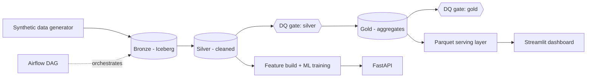

# Digital Payments Lakehouse

End-to-end data platform on **synthetic** digital-payments data: Spark + Apache Iceberg
lakehouse (bronze/silver/gold), Airflow orchestration with data-quality gates, SQL analytics,
a Streamlit dashboard, and ML models (customer segmentation and churn prediction) served via FastAPI.

> Data is synthetic, generated by `src/generate_data.py` with injected duplicates, nulls and
> negative amounts. The goal is to demonstrate pipeline design, data quality and ML methodology,
> not business conclusions.

## Architecture



## Stack
PySpark 3.5, Apache Iceberg 1.5, Airflow 2.9, DuckDB, scikit-learn, Streamlit, FastAPI, pytest.

## Pipeline

| Layer | What happens |
|---|---|
| Bronze | Raw parquet/CSV loaded as-is plus ingestion metadata (1,010,000 transactions) |
| Silver | Dedup on `txn_id`; invalid rows (null / non-positive amount) go to a `transactions_rejected` table with a reason (4,026 rejected; 996,019 clean) |
| Gold | Daily KPIs, volume by type, merchant stats |
| DQ gates | 9 silver and 5 gold checks (null/duplicate rates, uniqueness, valid status, row reconciliation). A failing check fails the Airflow task, so gold never builds from bad data |


*Airflow graph view of the pipeline. With a deliberately strict threshold, `dq_check_silver` turns red and `gold_aggregate` becomes `upstream_failed`; with normal thresholds the whole run is green.*

## Analytics

Findings from SQL (DuckDB) on the gold layer. The data is synthetic, so these demonstrate the analysis, not real business behaviour.

- Transfers are 37.4% of volume, QR payments 31.1%, bill pay 23.2%, top-ups 8.3%.
- The top 10% of users generate 39.9% of volume.
- Average cohort retention is 74.8% at month 1 and 51.6% at month 6, flattening around 46% by month 9.
- About 6% of transactions are non-successful (failed + pending).

Dashboard tabs: Overview, Merchants, Retention, Data quality, Segments.


## Machine learning

### Customer segmentation
K-Means on log-scaled, standardized RFM features (recency, frequency, monetary), with k=4 chosen by silhouette score (0.368).

| Segment | Share of users | Share of volume |
|---|---|---|
| Champions | 21% | 49% |
| At-risk high-value (win-back target) | 24% | 30% |
| Regulars | 30% | 16% |
| Lapsed low-value | 26% | 4% |

### Churn prediction
Label: no successful transaction in the 60 days after 2026-07-31. Features use only data before the cutoff to avoid leakage.

| Model | ROC-AUC | PR-AUC |
|---|---|---|
| Recency-only rule | 0.832 | n/a |
| Logistic regression | 0.881 | 0.763 |
| Gradient boosting | 0.900 | 0.801 (random: 0.268) |

**Threshold trade-off** (gradient boosting, test set):

| Threshold | Precision | Recall |
|---|---|---|
| 0.3 | 0.600 | 0.807 |
| 0.5 | 0.753 | 0.604 |
| 0.7 | 0.925 | 0.404 |

Lowering the threshold from 0.5 to 0.3 raises recall from 60% to 81% at the cost of precision, so the right cutoff depends on how expensive a missed churner is versus a wasted retention offer.

**Business result:** contacting only the top 20% highest-risk users captures 57.4% of all churners at 77.0% precision, versus 26.8% at random targeting. The top 30% captures 73.6%.

### API
`POST /predict/churn` returns a churn probability and risk band; `POST /segment` returns the customer segment. Interactive docs at `/docs`. Covered by 4 pytest tests.

## Run it

```bash
python3.11 -m venv .venv && source .venv/bin/activate
pip install -r requirements.txt     # needs Java 17
./run_pipeline.sh                   # generate data, build lakehouse, train models, run tests
streamlit run app/dashboard.py      # dashboard
uvicorn api.main:app --port 8000    # API docs at /docs
```

## Orchestration (Airflow)

The DAG `payments_lakehouse` (`dags/lakehouse_pipeline.py`) runs:
`bronze_ingest → silver_clean → dq_check_silver → gold_aggregate → dq_check_gold`.
If a data-quality check fails, downstream tasks do not run, so gold is never built from bad data.

Airflow runs in its own virtualenv (its dependencies conflict with PySpark's) and calls the
project venv's Python for each Spark job. Create the project `.venv` first (see "Run it").

```bash
python3.11 -m venv ~/airflow-venv
source ~/airflow-venv/bin/activate
pip install "apache-airflow==2.9.3" --constraint "https://raw.githubusercontent.com/apache/airflow/constraints-2.9.3/constraints-3.11.txt"

# from the project root
export AIRFLOW_HOME=$PWD/airflow_home
export AIRFLOW__CORE__DAGS_FOLDER=$PWD/dags
export AIRFLOW__CORE__LOAD_EXAMPLES=False
export OBJC_DISABLE_INITIALIZE_FORK_SAFETY=YES   # macOS only
export NO_PROXY="*"                              # macOS only
airflow standalone
```

Open http://localhost:8080, log in as `admin` (the password is printed in the terminal and saved in
`airflow_home/standalone_admin_password.txt`), un-pause the DAG and trigger it.

To see the gate working, run `python src/quality.py --stage silver --max-reject-rate 0.001`.
It exits with code 1, which turns the Airflow task red.

## Limitations
- Synthetic data: churn is generated as users stopping activity, so recency dominates the model.
  Merchant categories are random, so category rankings carry no signal.
- Local Spark in one process; Airflow uses the SequentialExecutor.
- Hadoop catalog on the local filesystem; production would use a REST/Glue/Hive catalog on object storage.
- Not covered: streaming ingestion (Kafka), Scala/Java.

## Structure
`src/` Spark jobs, DQ checks, ML training · `dags/` Airflow · `app/` dashboard · `api/` FastAPI · `tests/`
